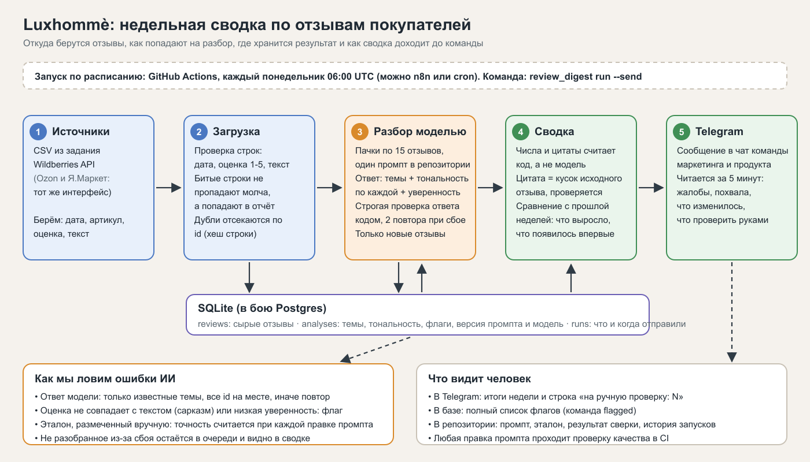

# Luxhommè: недельная сводка по отзывам покупателей

AI-помощник, который раз в неделю сам забирает свежие отзывы с маркетплейса, раскладывает их по темам и тону и присылает команде в Telegram короткую сводку: на что жалуются, что хвалят и что изменилось к прошлой неделе.

Тестовое задание: схема, рабочий прототип, разбор. Скринкаст на 2 минуты, от загрузки отзывов до сводки в Telegram: [docs/screencast.mp4](docs/screencast.mp4). Данные: 48 отзывов (две недели, четыре артикула), собраны вручную в формате из задания `DATE, SKU, RATING, TEXT`.

## 1. Схема решения



Коротко по пунктам из задания:

- **Откуда отзывы.** CSV (как в задании) или API маркетплейса. Для Wildberries написан адаптер `fetch_wildberries` (нужен токен продавца, вживую без токена не проверял). Ozon и Яндекс Маркет подключаются так же: источник отдаёт список `{дата, артикул, оценка, текст}`, всё остальное не меняется.
- **Как попадают на разбор.** Загрузка проверяет строки (дата, оценка 1-5, непустой текст), битые строки показывает в отчёте, дубли отсекает по id (хеш даты, артикула и текста). Повторная загрузка того же файла ничего не добавляет. На разбор идут только отзывы, у которых ещё нет разметки.
- **Где хранится результат.** SQLite-файл: сырые отзывы, разметка (темы, тональность, флаги, версия промпта и модель), история отправленных сводок. В бою заменяется на Postgres без изменения логики.
- **Как сводка доходит до команды.** Запуск по расписанию (GitHub Actions, понедельник утром, файл `.github/workflows/weekly-digest.yml`), результат уходит в Telegram через Bot API. Тот же запуск можно повесить на n8n или cron.

## 2. Рабочий прототип

Так выглядит сводка за неделю 05.10 - 11.10 (результат реального прогона на тестовых отзывах, теги форматирования убраны):

```
📊 Отзывы Luxhommè: 05.10 - 11.10

Отзывов: 28, средняя оценка 3.0; неделей ранее 20, оценка 3.8

🔥 На что жалуются
1. Шум: 6 (неделей ранее 2), RV-0707: 5 из 6
   «Застрял под кроватью, пришлось доставать, шум ужасный» (RV-0707, 1★)
   «Great blender, but a bit loud» (BL-4040, 4★)
2. Надёжность и качество: 5 (неделей ранее 1), все 5 - AF-5501
   «Перестала включаться через две недели, деньги вернули не сразу» (AF-5501, 1★)
   «Сломалась на третьей неделе, поддержка не отвечает 5 дней» (AF-5501, 1★)
3. Работа и результат: 4 (неделей ранее 1), все 4 - RV-0707
   «Шумит и застревает, зря потратил деньги» (RV-0707, 2★)
   «Застревает под диваном, шумит» (RV-0707, 2★)
4. Доставка: 3 (неделей ранее 0), все 3 - CM-2010
   «Курьер бросил коробку у двери, привезли через 10 дней» (CM-2010, 2★)
   «Доставка заняла 11 дней, кофемашина нормальная» (CM-2010, 3★)

👍 Что хвалят
• Работа и результат: 8
   «Классный блендер, лёд крошит без проблем» (BL-4040, 5★)
• Удобство и дизайн: 3
   «Удобные программы, ничего не пригорает» (AF-5501, 5★)

🔄 Что изменилось к прошлой неделе
📈 растёт: Надёжность и качество, жалоб 1 → 5, все 5 - AF-5501
📈 растёт: Шум, жалоб 2 → 6, RV-0707: 5 из 6
📈 растёт: Работа и результат, жалоб 1 → 4, все 4 - RV-0707
🆕 впервые заметно: Доставка, жалоб 0 → 3, все 3 - CM-2010
⬇️ AF-5501: средняя оценка 4.0 → 2.5 (8 отзывов)
⬇️ CM-2010: средняя оценка 4.2 → 3.3 (7 отзывов)

🧐 На ручную проверку: 2 (оценка не совпадает с текстом: 1)
```

Что здесь важно:

- Числа (сколько жалоб, сколько было раньше, средняя оценка) считает код, а не модель.
- Цитаты берутся из исходных отзывов, код проверяет, что цитата дословная (или её начало, если пришлось сократить).
- Вывод «растёт» появляется только когда жалоб не меньше трёх. Меньше трёх: показывается число без слова про тенденцию.
- Отзывы, которым нельзя доверять без человека, не прячутся в статистике, а вынесены в строку «на ручную проверку».

### Запуск

Нужен Python 3.10+ без сторонних библиотек.

```bash
# без ключей: берутся записанные ответы модели из data/llm_responses
PYTHONPATH=src python -m review_digest run --provider replay --week 2026-10-05

# вживую: ключ Anthropic и бот Telegram (см. .env.example)
export ANTHROPIC_API_KEY=... TELEGRAM_BOT_TOKEN=... TELEGRAM_CHAT_ID=...
PYTHONPATH=src python -m review_digest run --week 2026-10-05 --send

# проверка качества разметки на эталоне
PYTHONPATH=src python -m review_digest eval --provider replay

# тесты
python -m unittest discover -s tests -v
```

Другие команды: `ingest`, `analyze`, `digest`, `flagged` (список отзывов на ручную проверку).

### Что где лежит

| Путь | Назначение |
|---|---|
| `prompts/classify.md` | единственный промпт: темы, правила, формат ответа |
| `src/review_digest/analyze.py` | пачки по 15 отзывов, строгая проверка ответа модели, флаги |
| `src/review_digest/digest.py` | подсчёт, сравнение с прошлой неделей, цитаты, текст сообщения |
| `src/review_digest/llm.py` | провайдеры: `anthropic` (API), `replay` (записанные ответы), `mock` (ключевые слова, для тестов) |
| `data/reviews.csv`, `data/gold_labels.csv` | отзывы и эталонная разметка |
| `data/llm_responses/` | записанные ответы модели (по хешу запроса) |
| `tests/` | 15 тестов |

## 3. Как я проверял, что ИИ не ошибается в темах

Модели нельзя верить на слово, поэтому проверка встроена в сам конвейер, а не сделана один раз руками.

1. **Закрытый список тем и строгий формат.** Модель отвечает JSON с темами из фиксированного списка (`prompts/classify.md`). Код отвергает ответ, если есть неизвестная тема, тональность не `pos/neg/neu`, не хватает отзывов, есть лишний или повторный id, уверенность вне 0-1. Невалидная пачка повторяется два раза, дальше отзывы остаются в очереди и сводка честно пишет, сколько не разобрано.
2. **Модель не пишет цифры и цитаты.** Она только ставит метки. Счёт и цитаты делает код, поэтому выдумать жалобу или подправить цитату нельзя.
3. **Опасные случаи уходят человеку.** Оценка 5 при жалобе в тексте (сарказм), низкая уверенность, отзыв «не про товар» получают флаг. В тестовых данных так пойман отзыв «Ну просто праздник, застрял в третий раз за день, 10 из 10» с оценкой 5 и спам про чужой телеграм-канал.
4. **Эталон и точность.** Я вручную разметил все 48 отзывов (`data/gold_labels.csv`). Команда `eval` сравнивает с ними ответы модели: точность и полнота по темам, совпадение тональности, построчный список расхождений. В CI стоит порог: правка промпта или смена модели не проходит, если F1 ниже 0.85.
5. **Отзыв не командует моделью.** В промпте прямо сказано, что текст отзыва это данные, а не инструкции.
6. **Для продакшена:** раз в неделю человек смотрит 20 случайных отзывов с метками, результат дописывается в эталон.

Результаты на тестовых данных (модель: Claude Sonnet 5.5):

| Прогон | F1 по темам | Тональность | Все метки отзыва совпали |
|---|---|---|---|
| Ключевые слова без модели (нижняя планка) | 89% | 84% | 62% |
| Модель, первый промпт | 95% | 97% | 85% |
| Модель, после правки правил промпта | 96% | 100% | 90% |

Что показал первый прогон: модель относила «застревает под диваном» к удобству, а не к работе техники, добавляла «общее впечатление» к отзывам с конкретными темами, а спаму ставила разную тональность. Я уточнил в промпте границы этих тем и правило для спама (тональность всегда нейтральная, это же поправил в эталоне) и прогнал заново. Оставшиеся расхождения: модель иногда не ставит вторую тему в коротких отзывах («Great blender, but a bit loud» получил только шум), а один отзыв про карту получил лишнюю тему про приложение.

Честные ограничения: отзывы синтетические, эталон размечал один человек (я), набор маленький. На 48 отзывах 96% не означает 96% на настоящих данных: настоящая проверка начинается, когда маркетинг разметит 100-200 живых отзывов.

## 4. Что я сделал бы иначе в продакшене

- Подключил бы все маркетплейсы бренда и забирал отзывы по id отзыва с маркетплейса, а не по хешу текста.
- Хранил бы историю разметки по версиям промпта, чтобы после правки правил пересчитать прошлые недели и не сравнивать разные способы разметки.
- Добавил бы срочный сигнал между сводками: если за сутки жалоб на один артикул больше обычного, сообщение приходит сразу.
- Развёл бы темы по категориям товара: «шум» у блендера и у пылесоса значат разное, и список тем для кофемашины отличается от списка для пылесоса.
- Дал бы в сводке ссылку на полный список отзывов по каждой теме, чтобы любой жалобе можно было посмотреть первоисточник.
- Считал бы расход на модель по каждому запуску и писал в историю.
- Черновики ответов покупателям на жалобы поддержки: сначала на ручное одобрение.

## 5. Вопросы маркетингу и продукту до старта

1. Какие маркетплейсы и сколько отзывов в неделю? От этого зависит способ получения (API, выгрузка) и стоимость.
2. Кто читает сводку и когда? Один чат на всех или разные сводки для маркетинга, продукта и поддержки?
3. Какие темы важны именно вам? Мой список из 11 тем стартовый, нужен список от людей, которые знают покупателей.
4. Нужна сводка по бренду целиком или по каждому артикулу? Какой минимум отзывов считать сигналом?
5. Что делать с отзывами без текста, с фото и видео, с чужой рекламой и с отзывами конкурентов?
6. Нужно ли связать отзывы с возвратами и продажами, чтобы видеть не только число жалоб, но и их долю в продажах?
7. Какие жалобы срочные (безопасность, перегрев) и должны уходить сразу, а не раз в неделю?
8. Кто принимает решение, если модель и человек разметили отзыв по-разному, и где хранится окончательная разметка?

## 6. Чего здесь нет и что не проверено

- Ответы модели для демонстрации записаны заранее (`data/llm_responses/`): в среде, где я делал задание, не было ключа API. Разметку сделала модель Claude Sonnet 5.5 строго по промпту из репозитория, ответы сохранены без правок и проходят ту же проверку кодом, что и живые. Режим `replay` повторяет прогон на любом компьютере без ключей.
- Провайдер `anthropic` (живой вызов API) проверен тестом на локальном поддельном сервере: форма запроса, заголовки, разбор ответа. На реальном API я его не запускал.
- Адаптер Wildberries написан по публичной документации и не проверялся на живом токене.
- Отправка в Telegram: код есть (`telegram.py`), на скринкасте показана реальная отправка.
